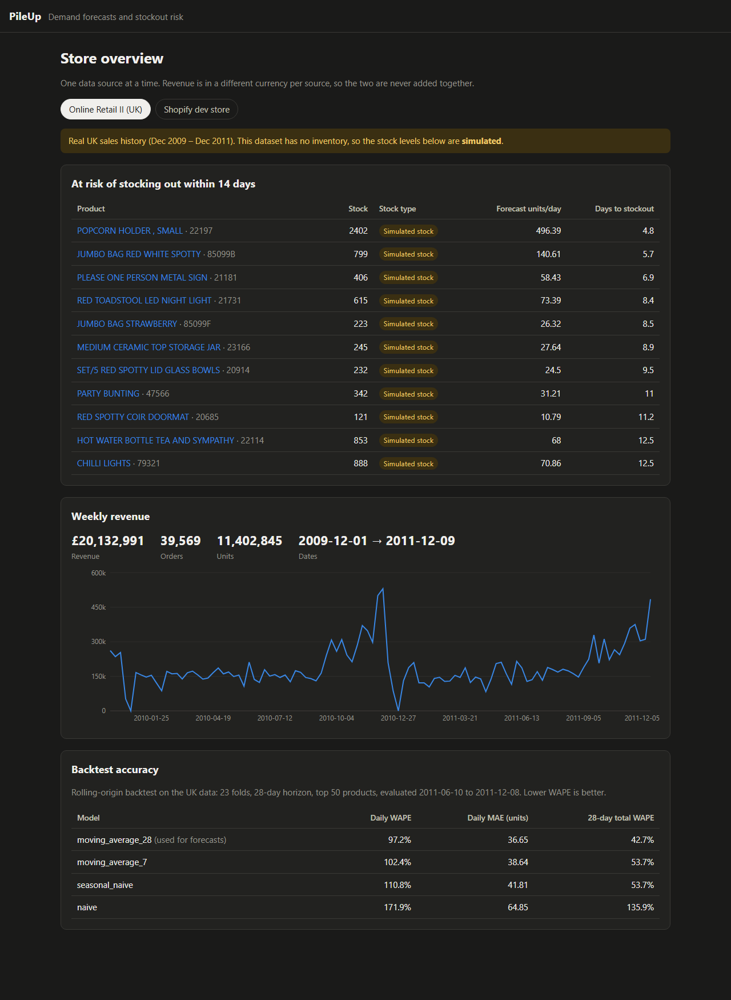
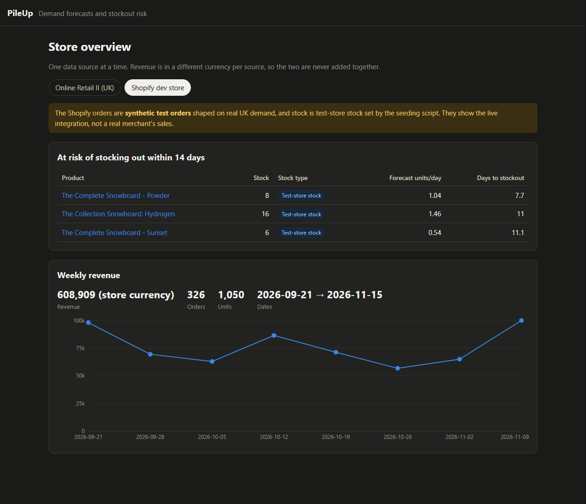
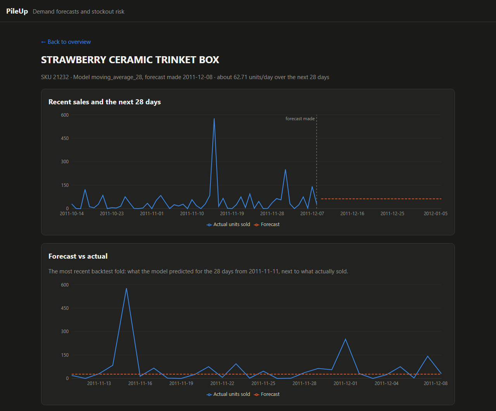
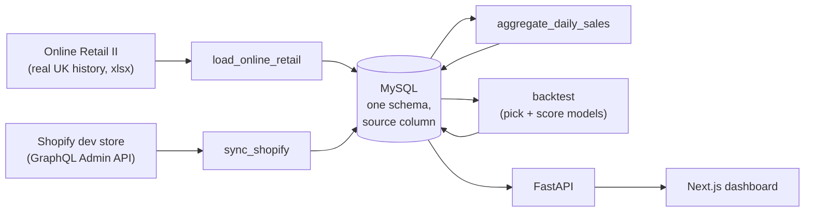

# PileUp

PileUp predicts which products a store is about to run out of. It pulls orders and products from a Shopify store into MySQL, forecasts each product's daily demand, works out how many days of stock are left, and shows the products at risk on a small dashboard.

It runs on two data sources that share one schema:

- **Online Retail II**: two years of real transactions from a UK online gift retailer. This is where the forecasting models are tested and scored.
- **A Shopify development store**: synced live through the GraphQL Admin API. This proves the integration works end to end: pagination, rate limits and incremental syncs.



<details>
<summary>More screenshots: the Shopify store view and a product forecast</summary>





</details>

## Why

Running out of a popular product loses sales, and over-ordering ties up cash. A merchant really needs one answer: "what do I need to reorder this week?" I wanted to build that end to end on real data, from raw orders to a forecast someone could act on. I also wanted the accuracy measured honestly rather than assumed.

## Architecture



Both loaders write to the same tables (`products`, `orders`, `order_lines`, `inventory_snapshots`, `daily_sales`, `forecasts`), and a `source` column tells the two apart. So everything downstream (aggregation, forecasting, the API and the dashboard) runs the same way on either source.

**Stack:** Python 3.12, pandas, NumPy, SQLAlchemy Core, MySQL 8, FastAPI, httpx, Next.js (App Router, TypeScript), Recharts, pytest, ruff.

## How the forecast is tested

The models are scored with a **rolling-origin backtest**, not a random train/test split. A random split leaks future sales into training and makes the accuracy look better than it is.

- Train on all history before a cutoff, forecast the next 28 days, then move the cutoff forward 7 days and repeat. That's 23 folds over the last 6 months of the data.
- The test covers the 50 best-selling products by revenue, ranked using only sales before the first cutoff.
- The models are simple baselines: naive (repeat yesterday), seasonal naive (repeat last week), and 7- and 28-day moving averages.
- The metric is WAPE (total absolute error / total actual units). MAPE isn't used, because most product-days have zero sales and those break it.

Results (from [`docs/backtest_results.md`](docs/backtest_results.md)):

| Model | Daily WAPE | Daily MAE (units/day) | 28-day total WAPE |
|---|---|---|---|
| moving_average_28 | 97.2% | 36.65 | 42.7% |
| moving_average_7 | 102.4% | 38.64 | 53.7% |
| seasonal_naive | 110.8% | 41.81 | 53.7% |
| naive | 171.9% | 64.85 | 135.9% |

How to read it:

- **Daily WAPE** scores each single day. Daily sales for one product are very spiky, so no simple model does well day to day. Near 100% is about as good as predicting zero.
- **28-day total WAPE** scores each product's total demand over the next four weeks, which is the number days-to-stockout actually uses. Here the 28-day moving average cuts error from 135.9% (naive) to 42.7%.
- The 28-day moving average wins on both measures, so it makes the live forecasts.

**Days to stockout** = current stock ÷ forecast daily demand. A product is flagged when that's under 14 days.

## Simulated and synthetic data (please read)

Neither source has a real merchant's inventory, so be clear about what's real:

- **Online Retail II has no stock levels.** The UK stock figures are **simulated** (each product gets a random 3–45 days of its recent demand). The database and the dashboard label them "Simulated stock".
- **The Shopify orders are synthetic test orders.** A seeding script replayed 56 days of real UK demand (top 15 products, scaled down to 0.5–2 units a day) into the dev store as 326 backdated test orders. Shopify stock is test-store stock set by that same script, and is labelled "Test-store stock".
- **No accuracy is reported on Shopify data.** Measuring a model on orders I generated wouldn't mean anything. Shopify forecasts use the model the UK backtest picked.
- Revenue is in GBP for the UK data and in the store's currency for Shopify, so the two are never added together.

## Running it locally

You need Python 3.12, MySQL 8 and Node 20.

**1. Configure.** Copy `.env.example` to `.env` and fill it in. The Shopify values come from an app in Shopify's Dev Dashboard, installed on a development store with custom distribution. Then copy `frontend/.env.local.example` to `frontend/.env.local`.

**2. Database**
```bash
mysql -u root -p -e "CREATE DATABASE shopify_insights"
mysql -u root -p shopify_insights < backend/schema.sql
```

**3. Backend and pipeline.** Run these from `backend/`. First download Online Retail II from https://archive.ics.uci.edu/static/public/502/online+retail+ii.zip and unzip the xlsx into `data/raw/online_retail_II.xlsx`.
```bash
python -m venv .venv
source .venv/Scripts/activate            # Windows Git Bash; macOS/Linux: source .venv/bin/activate
pip install -r requirements.txt

python -m pipeline.load_online_retail     # clean and load the UK history
python -m pipeline.seed_shopify_demand    # one-time: synthetic test orders + stock in your dev store (~70 min, rate limited)
python -m pipeline.sync_shopify           # store -> MySQL (incremental; --full to resync from scratch)
python -m pipeline.aggregate_daily_sales  # daily sales per product, zero-filled
python -m forecast.backtest               # score the models -> docs/backtest_results.md
python -m pipeline.simulate_inventory     # simulated UK stock levels
python -m forecast.forecast_shopify       # 28-day forecasts for the Shopify products

uvicorn app.main:app --reload             # API at http://localhost:8000/docs
```

**4. Dashboard**
```bash
cd frontend
npm install
npm run dev                               # http://localhost:3000
```

**Tests and lint** (from `backend/`): `pytest` and `ruff check .`. The API tests run against the local database, so the pipeline has to have run first.

## API

| Endpoint | What it returns |
|---|---|
| `GET /products/at-risk?threshold_days=14&source=` | Products that run out within the threshold, soonest first, with stock labelled simulated or not |
| `GET /sales/summary?source=online_retail\|shopify` | Totals and weekly revenue for one source |
| `GET /forecast/{product_id}` | 28-day forecast, recent sales and the latest backtest fold (404 for unknown products) |
| `GET /backtest/summary` | The backtest results |

## Project layout

```
backend/
  app/        FastAPI app and routes
  pipeline/   loading, cleaning, Shopify client, sync and seeding
  forecast/   models, backtest, Shopify forecasts
  tests/
frontend/     Next.js dashboard
docs/         backtest results
```

## Data source and license

Online Retail II, by Chen, D. (2012), UCI Machine Learning Repository, https://doi.org/10.24432/C5CG6D. Licensed under [CC BY 4.0](https://creativecommons.org/licenses/by/4.0/).

Cleaning rules, each covered by a test:
- Cancelled invoices are excluded.
- Non-product codes (postage, fees, manual adjustments) are excluded.
- Zero or negative prices and quantities are excluded.
- Stock codes are uppercased, because the same code appears in both cases.
- The last day (2011-12-09) is dropped because it's a partial day.
